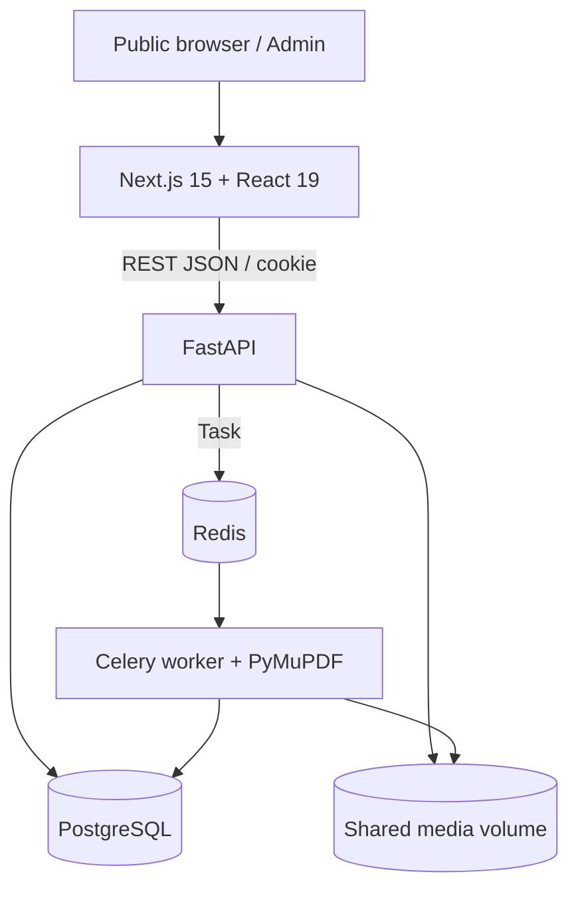

# Architecture

- Monorepo, code độc lập `frontend/`, `backend/`.
- Next.js SSR for public routes, client-side interactions for admin/PDF.
- API prefix `/api/v1`, Swagger/OpenAPI tự sinh, Python sync SQLAlchemy sessions.
- Backend modules: `auth`, `api`, `models`, `importer`, `tasks`, `seed`.
- Storage: volume `mediadata` chia sẻ giữa FastAPI và Celery để xử lý PDF và tạo ảnh bìa; có thể thay bằng S3/MinIO về sau.
- SQL migrations: Alembic revision 0143e994c094.
- Authentication: Argon2 + HS256 JWT HttpOnly cookie + double-submit CSRF cookie.
- Vai trò đang có: `admin` (publish), `editor` (sửa nội dung). Chưa có permission matrix.

## Data flow import

1. Upload PDF tới `/api/v1/admin/issues/import-pdf`.
2. FastAPI ghi tệp vào volume và tạo `import_jobs`.
3. Task Celery đọc PDF, trích xuất bìa, mục lục, raw text, tạo issue ở trạng thái `draft`.
4. Status `needs_review`; biên tập viên đối chiếu qua UI.
5. Admin publish; public API trả issue và danh sách bài đã công bố. HTML body chỉ trả nếu đã được kiểm chứng.

## Production hardening chưa triển khai

- TLS reverse proxy và domain thực.
- Object storage S3/MinIO (hiện đang local shared volume).
- Khống chế CPU/RAM/time cho worker và chống PDF độc hại.
- Redis durable queues, retry/dead-letter, idempotent task boundaries.
- Refresh token rotation, rate limiting, monitoring, backup/restore, secrets manager.
