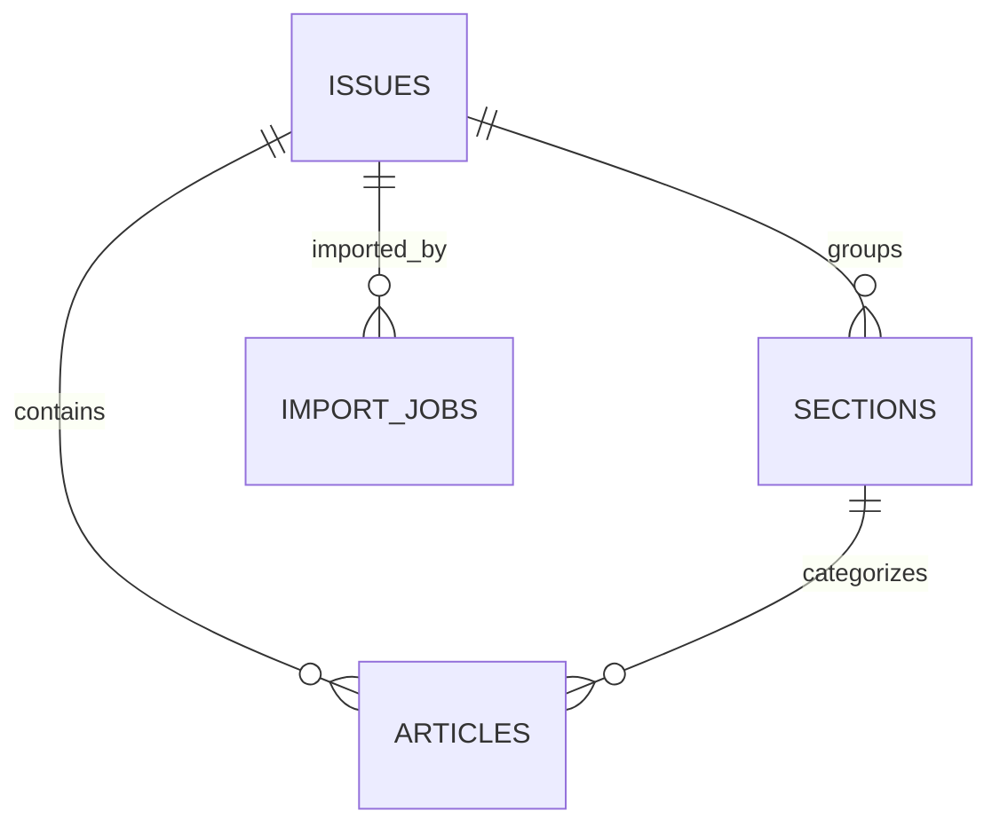

# Database schema

Các bảng đã triển khai trong Alembic:

| Bảng | Vai trò |
|---|---|
| users | Tài khoản admin/editor, hash mật khẩu |
| issues | Số, kỳ, PDF, bìa, lời thưa, imprint, publish state |
| sections | Chuyên mục riêng từng số |
| articles | Mục nội dung, tác giả hiển thị, trang PDF, toàn văn, trạng thái hiệu đính |
| import_jobs | Trạng thái xử lý PDF bất đồng bộ |
| audit_logs | Log hành động cập nhật bài và xuất bản |

### Bổ sung trong giai đoạn sau

- `authors` / `article_authors` để chuẩn hóa tác giả (MVP dùng `author_display` lưu nguyên tên trong PDF).
- `media_files`, `document_categories`, `documents`, `notices`, `activities`, `subscribers`, `site_settings`.
- `refresh_sessions` và bảng permission-role chi tiết.

Không chỉnh sửa migration đã chạy trong production, tạo revision mới bằng Alembic khi thay đổi schema.
